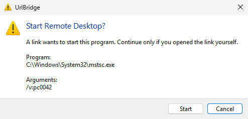

#  UrlBridge

<!-- web:skip -->
[English](#english) · [Deutsch](#deutsch)
<!-- /web:skip -->

## English

UrlBridge lets a web page open a local program on Windows through a custom URL protocol, for example `bridge-rdp://pc0042` → `mstsc.exe /v:pc0042`.
Which protocols exist, which program each one starts and which values are allowed is defined by an administrator in a single configuration file. Everything that arrives in a link is treated as hostile input: it is validated strictly, it can only fill placeholders in fixed arguments, and nothing starts without your confirmation.

> Feedback and bug reports are welcome as [issues](../../issues); please report security problems as described in [SECURITY.md](SECURITY.md). Not affiliated with or endorsed by Microsoft. Windows is a trademark of the Microsoft group of companies.

<p></p>

### Features
- Any number of custom URL protocols, each mapped to one program with fixed arguments
- Strict built-in value types instead of free text (`host`, `hostname`, `ipv4`, `integer`, `token`, `choice`)
- Confirmation dialog before every start, showing the program and its full arguments
- No shell, no `ShellExecute`, no `PATH` lookup
- Refuses to run if the configuration, UrlBridge itself or a local target program can be modified by standard users
- Every start, cancellation and rejected link is written to the Windows event log
- Installation by PowerShell script, suitable for software distribution
- No network access, no telemetry (see [Privacy](#privacy))

### Installation
Download `UrlBridge-<version>-windows-x64.zip` from [Releases](../../releases) and extract it. Installation requires administrator rights; UrlBridge is always installed for all users.

The program is not signed, so SmartScreen or your antivirus may warn. The ZIP has a `.sha256` file to verify the download, and the release notes link a VirusTotal scan. Changes are listed in the [changelog](CHANGELOG.md).

1. Write your configuration based on `UrlBridge.example.json` (see [Configuration](#configuration)).
2. Run the installer from an elevated Windows PowerShell:

```powershell
powershell.exe -ExecutionPolicy Bypass -File .\Install.ps1 -ConfigPath .\UrlBridge.json
```

The script
- copies the program to `C:\Program Files\UrlBridge` (an existing configuration is kept if `-ConfigPath` is omitted),
- runs `UrlBridge.exe --validate` and stops on errors; a previous installation is restored in that case,
- registers every configured protocol under `HKLM\Software\Classes` and removes protocols that are no longer configured (it never overwrites a protocol that belongs to another program),
- creates the event log source `UrlBridge`,
- adds an entry under *Settings → Apps* for inventory and uninstallation.

Run it again to apply a changed configuration or to update the program. `Uninstall.ps1` removes the program, its protocols, the event log source and the entry under *Settings → Apps*, which runs the same script.

Both scripts also work from a 32-bit host such as a software distribution client; they restart themselves in 64-bit PowerShell.

#### Exit codes of the scripts
| Code | Meaning |
|---|---|
| 0 | Success |
| 1 | No administrator rights or invalid parameters |
| 2 | Configuration invalid (`--validate` failed) |
| 3 | Copying failed |
| 4 | Registration failed, e.g. the protocol belongs to another program |

### Usage
Clicking a link such as `bridge-rdp://pc0042` in the browser starts UrlBridge. It shows a confirmation with the protocol, program and arguments; the program starts only after you confirm. Cancel is the default button. If the link is rejected, the target program is missing or the configuration is invalid, a short message says so and nothing starts.

From a console:

| Command | Effect |
|---|---|
| `UrlBridge.exe <url>` | Validate, ask for confirmation, start |
| `UrlBridge.exe --test <url>` | Show the program and arguments that would be started, start nothing |
| `UrlBridge.exe --validate` | Check the whole configuration and list all problems |
| `UrlBridge.exe --version` | Show the version |
| `UrlBridge.exe --help` | Show the help; without parameters UrlBridge does nothing else |

UrlBridge is a window application, so a console does not wait for it. In scripts, use `Start-Process -Wait -PassThru` and read `ExitCode`:

| Code | Meaning |
|---|---|
| 0 | Started, or check passed |
| 1 | Invalid command line |
| 2 | Configuration invalid or unsafe (permissions) |
| 3 | Link rejected |
| 4 | Cancelled by the user |
| 5 | Program not found or could not be started |

#### Browser prompts
Edge and Chrome ask before opening an external protocol ("This site is trying to open UrlBridge"). To skip that prompt for trusted sites, set the browser policy `AutoLaunchProtocolsFromOrigins` by group policy (ADMX templates for Edge and Chrome), for example:

```json
[{ "protocol": "bridge-rdp", "allowed_origins": ["https://intranet.example.com"] }]
```

The policy applies per protocol and per origin; protocols that are not listed keep the browser prompt. The install script deliberately does not set browser policies. UrlBridge still asks for confirmation before every start.

### Configuration
The configuration is `C:\Program Files\UrlBridge\UrlBridge.json`; its location cannot be changed. UTF-8 without BOM, at most 64 KiB, at most 64 protocols with 32 arguments and 8 parameters each.

```json
{
  "protocols": [
    {
      "scheme": "bridge-rdp",
      "name": "Remote Desktop",
      "program": "C:\\Windows\\System32\\mstsc.exe",
      "arguments": ["/v:{host}"],
      "parameters": [
        { "name": "host", "type": "host" }
      ]
    }
  ]
}
```

**If the configuration is invalid or unsafe, nothing starts**, not even the protocols that are correct. Every call runs the same check as `--validate`.

A target program that does not exist on a computer is not an error of the configuration: `--validate` only warns, the other protocols keep working, and a link to the missing program shows a message that it was not found.

The parser is strict: duplicate keys, unknown fields, comments, trailing commas and missing required fields are errors.

| Field | Required | Rules |
|---|---|---|
| `protocols[].scheme` | yes | Lowercase letters, digits, `-`, `.`, `+`; starts with a letter; 3–64 characters; unique; never a well-known scheme such as `http`, `https`, `file`, `mailto` or `ms-*`; must not start with `url`, because Windows does not open such protocols |
| `protocols[].name` | yes | 1–64 characters; shown in the confirmation dialog and in the registry |
| `protocols[].program` | yes | Absolute path to an `.exe`, local (`C:\…`) or UNC (`\\server\share\…`). Local programs must be on a fixed drive. Not allowed: mapped drive letters, environment variables, `..`, `\\?\`, `\\.\` |
| `protocols[].arguments` | yes | Fixed arguments; `{name}` placeholders only for declared parameters, each parameter used at least once |
| `protocols[].parameters` | yes | Ordered list; defines number and order of the values in the link |
| `parameters[].name` | yes | Letters and digits, starts with a letter, 1–32 characters |
| `parameters[].type` | yes | See value types |
| `parameters[].min`, `max` | for `integer` | Allowed range, 0–4294967295 |
| `parameters[].maxLength` | for `token` | 1–256 |
| `parameters[].values` | for `choice` | Fixed list of 1–64 allowed values |

#### Link format
`scheme://value1/value2/…`
- The number of values must match the number of parameters exactly. A single trailing `/` is ignored.
- Rejected: query (`?`), fragment (`#`), user info (`@`), empty values, links longer than 2048 characters.
- Percent-encoding is decoded exactly once before validation; invalid encoding or invalid UTF-8 is rejected.
- The command line must contain exactly one argument after the program; anything else is rejected.

#### Value types
| Type | Allowed |
|---|---|
| `hostname` | DNS name: `A–Z a–z 0–9 - .`; labels 1–63, total 1–253 characters; no `-` at the start or end of a label; no empty labels |
| `ipv4` | Four decimal numbers 0–255 without leading zeros |
| `host` | `hostname` or `ipv4` |
| `integer` | Decimal number without sign or leading zeros, within `min`–`max` |
| `token` | `A–Z a–z 0–9 - _`, length 1–`maxLength` |
| `choice` | Exactly one of `values` (case-sensitive) |

Regardless of the type, a value consists only of `A–Z a–z 0–9 - _ .`, has 1–256 characters and never starts with `-`. Spaces, quotes, slashes, backslashes, `%`, control characters and anything outside ASCII are always rejected. Values can therefore neither break out of an argument nor add options of their own.

### How it works
Windows starts `UrlBridge.exe "<link>"` for every link to a registered protocol. Each call is a separate short process: load and check the configuration and permissions, parse and validate the link, build the argument list, check the target program, ask for confirmation, start the program, write an event log entry, exit. There is no background process and no communication between processes.

#### Threat model
- *A web page.* Any page can trigger a link to a registered protocol. Everything in the link is hostile input; validation and the confirmation dialog protect against it. Browsers pass special characters percent-encoded, and Edge does not open links with raw quotes or spaces at all; UrlBridge does not rely on either.
- *A user or process without administrator rights* trying to change the configuration, UrlBridge, a target program or their folders, or to redirect them through drive letters, environment variables, `PATH` or DLLs placed next to the program.
- *Not covered:* administrators. Whoever can write to `C:\Program Files` does not need UrlBridge to run programs. A user can also register a protocol of the same name for their own account only, which affects nobody else.

#### Starting programs
- `CreateProcessW` with an explicit program path; no shell, no `ShellExecute`, no `PATH` lookup. The working directory is the program's folder.
- Only `.exe` files. `CreateProcessW` silently runs `.bat` and `.cmd` through `cmd.exe`, whose own command line parsing could undo the validation, and batch files cannot be signed.
- Interpreters such as `cmd.exe`, `powershell.exe` or `wscript.exe` are allowed, because a block list is trivially bypassed by copying or renaming and only administrators can change the configuration. `--validate` warns about them: with an interpreter, values can turn into code.
- UrlBridge loads its own libraries only from the Windows system folder.

#### Permission check
On every call and during `--validate`, for the configuration, UrlBridge itself and local target programs; the program of the called protocol is checked again right before the confirmation.
- Only SYSTEM, Administrators and TrustedInstaller may be able to modify the file (write, append, delete, change permissions or owner) and the folder that contains it (the same, plus creating files or subfolders, to prevent DLL planting).
- In every folder above that, up to the drive root, nobody else may delete or rename entries or change permissions or owner, so that no folder on the path can be swapped. Creating new folders there is tolerated, because Windows allows it on `C:\` by default.
- The owner must be one of these as well. Inherit-only entries such as `CREATOR OWNER` are ignored.
- Permissions that cannot be read count as a failure.
- Programs on network shares (UNC paths) are not checked. Write access there is managed on the file server, often with time-based or just-in-time permissions that UrlBridge cannot evaluate; protecting the share is the file server administrator's responsibility.

#### Event log
Source `UrlBridge` in the *Application* log, with the Windows user of the call. There is no log file.

| Event ID | Level | Meaning |
|---|---|---|
| 1 | Information | Program started (protocol, program, arguments, link) |
| 2 | Information | Cancelled by the user |
| 3 | Warning | Link rejected, with reason |
| 4 | Error | Configuration invalid, nothing started |
| 5 | Error | Program not found or could not be started |

### Privacy
UrlBridge has no network access of its own. It sends and retrieves nothing and does not check for updates. Programs on network shares are read by Windows like any other file. The event log records the Windows user, the protocol, the values and the program of each call.

<!-- web:skip -->

### Building
UrlBridge is written in Rust (1.90 or later, MSVC toolchain) and only depends on the official Windows API bindings; the JSON parser is part of UrlBridge.

```
cargo build --release
```

`scripts\New-Package.ps1` builds the program and collects the package in `dist\UrlBridge-<version>`; with `-Zip` it also creates the release archive and its `.sha256` file.

The icons in [`assets/icons`](assets/icons) (ICO and PNG in all common sizes) are generated from `icon.svg` with [`render-icons.mjs`](https://github.com/TripleT3005/TripleT3005/blob/main/scripts/render-icons.mjs), which needs Node.js and Edge or Chrome: `node render-icons.mjs assets/icons`.

The license list for releases is created with Python 3 (standard library only): `python scripts/third_party_licenses.py --rust-std --output THIRD-PARTY-LICENSES.txt`. `python -m unittest discover -s scripts` tests the script.

A release is created automatically when a new version in `Cargo.toml` reaches `main`. Each version needs a section with English and German notes in [CHANGELOG.md](CHANGELOG.md), which becomes the release notes; tests and pipeline fail without it.

Dependabot updates of components built into UrlBridge are not entered in the changelog one by one, but collected in the section of the next version, in English and German, e.g. `Updated third-party components: windows-sys 0.61.3.` `python scripts/dependency_updates.py` lists them since the last release and suggests the entry. The release pipeline fails if one of them is missing from the section of the new version.

<!-- /web:skip -->

### License
[MIT](LICENSE)

Release packages include `THIRD-PARTY-LICENSES.txt` with the licenses of all third-party components built into UrlBridge. The CI fails if a dependency uses a license that is not on the allow list in [`scripts/third_party_licenses.py`](scripts/third_party_licenses.py).

## Deutsch

Mit UrlBridge kann eine Webseite unter Windows ein lokales Programm über ein eigenes URL-Protokoll öffnen, zum Beispiel `bridge-rdp://pc0042` → `mstsc.exe /v:pc0042`.
Welche Protokolle es gibt, welches Programm sie starten und welche Werte erlaubt sind, legt ein Administrator in einer einzigen Konfigurationsdatei fest. Alles, was in einem Link ankommt, gilt als feindliche Eingabe: Es wird streng geprüft, kann nur Platzhalter in festen Argumenten füllen, und ohne deine Bestätigung startet nichts.

> Rückmeldungen und Fehlerberichte sind als [Issues](../../issues) willkommen; Sicherheitsprobleme bitte wie in [SECURITY.md](SECURITY.md) beschrieben melden. Keine Verbindung zu Microsoft und nicht von Microsoft unterstützt. Windows ist eine Marke der Microsoft-Unternehmensgruppe.

<p></p>

### Funktionen
- Beliebig viele eigene URL-Protokolle, jedes mit einem Programm und festen Argumenten
- Strenge eingebaute Wertetypen statt freiem Text (`host`, `hostname`, `ipv4`, `integer`, `token`, `choice`)
- Bestätigungsdialog vor jedem Start, der das Programm und alle Argumente zeigt
- Keine Shell, kein `ShellExecute`, keine Suche im `PATH`
- Startet nichts, wenn Standardbenutzer die Konfiguration, UrlBridge selbst oder ein lokales Zielprogramm verändern können
- Jeder Start, jeder Abbruch und jeder abgelehnte Link steht im Windows-Ereignisprotokoll
- Installation per PowerShell-Skript, geeignet für die Softwareverteilung
- Kein Netzwerkzugriff, keine Telemetrie (siehe [Datenschutz](#datenschutz))

### Installation
`UrlBridge-<Version>-windows-x64.zip` von [Releases](../../releases) herunterladen und entpacken. Die Installation braucht Administratorrechte; UrlBridge wird immer für alle Benutzer installiert.

Das Programm ist nicht signiert, daher können SmartScreen oder der Virenscanner warnen. Zur ZIP gibt es eine `.sha256`-Datei zum Prüfen des Downloads, und die Release-Notizen verlinken einen VirusTotal-Scan. Änderungen stehen im [Changelog](CHANGELOG.md).

1. Die eigene Konfiguration nach dem Muster von `UrlBridge.example.json` schreiben (siehe [Konfiguration](#konfiguration)).
2. Das Installationsskript in einer Windows PowerShell mit Administratorrechten ausführen:

```powershell
powershell.exe -ExecutionPolicy Bypass -File .\Install.ps1 -ConfigPath .\UrlBridge.json
```

Das Skript
- kopiert das Programm nach `C:\Program Files\UrlBridge` (ohne `-ConfigPath` bleibt eine vorhandene Konfiguration erhalten),
- führt `UrlBridge.exe --validate` aus und bricht bei Fehlern ab; eine vorherige Installation wird dann wiederhergestellt,
- registriert jedes Protokoll der Konfiguration unter `HKLM\Software\Classes` und entfernt Protokolle, die nicht mehr konfiguriert sind (ein Protokoll, das einem anderen Programm gehört, wird nie überschrieben),
- legt die Ereignisquelle `UrlBridge` an,
- erstellt einen Eintrag unter *Einstellungen → Apps* für Inventarisierung und Deinstallation.

Für eine geänderte Konfiguration oder ein Update das Skript erneut ausführen. `Uninstall.ps1` entfernt das Programm, seine Protokolle, die Ereignisquelle und den Eintrag unter *Einstellungen → Apps*, der dasselbe Skript aufruft.

Beide Skripte funktionieren auch aus einem 32-Bit-Host, etwa dem Client einer Softwareverteilung; sie starten sich selbst in der 64-Bit-PowerShell neu.

#### Exit-Codes der Skripte
| Code | Bedeutung |
|---|---|
| 0 | Erfolgreich |
| 1 | Keine Administratorrechte oder ungültige Parameter |
| 2 | Konfiguration ungültig (`--validate` fehlgeschlagen) |
| 3 | Kopieren fehlgeschlagen |
| 4 | Registrierung fehlgeschlagen, z. B. weil das Protokoll einem anderen Programm gehört |

### Bedienung
Ein Klick auf einen Link wie `bridge-rdp://pc0042` im Browser startet UrlBridge. Es zeigt eine Bestätigung mit Protokoll, Programm und Argumenten; das Programm startet erst, wenn du bestätigst. „Cancel“ ist vorausgewählt. Wird der Link abgelehnt, fehlt das Zielprogramm oder ist die Konfiguration ungültig, erscheint eine kurze Meldung, und nichts startet. Die Oberfläche ist derzeit nur englisch.

In der Konsole:

| Befehl | Wirkung |
|---|---|
| `UrlBridge.exe <url>` | Prüfen, Bestätigung anzeigen, starten |
| `UrlBridge.exe --test <url>` | Zeigt Programm und Argumente, die gestartet würden, startet aber nichts |
| `UrlBridge.exe --validate` | Prüft die ganze Konfiguration und listet alle Probleme auf |
| `UrlBridge.exe --version` | Zeigt die Version |
| `UrlBridge.exe --help` | Zeigt die Hilfe; ohne Parameter tut UrlBridge sonst nichts |

UrlBridge ist eine Fensteranwendung, eine Konsole wartet deshalb nicht auf sie. In Skripten `Start-Process -Wait -PassThru` verwenden und `ExitCode` auslesen:

| Code | Bedeutung |
|---|---|
| 0 | Gestartet bzw. Prüfung ohne Fehler |
| 1 | Ungültiger Aufruf |
| 2 | Konfiguration ungültig oder unsicher (Rechte) |
| 3 | Link abgelehnt |
| 4 | Vom Benutzer abgebrochen |
| 5 | Programm nicht gefunden oder Start fehlgeschlagen |

#### Rückfragen des Browsers
Edge und Chrome fragen nach, bevor sie ein externes Protokoll öffnen („This site is trying to open UrlBridge“). Für vertrauenswürdige Seiten lässt sich diese Rückfrage mit der Browser-Richtlinie `AutoLaunchProtocolsFromOrigins` per Gruppenrichtlinie abschalten (ADMX-Vorlagen für Edge und Chrome), zum Beispiel:

```json
[{ "protocol": "bridge-rdp", "allowed_origins": ["https://intranet.example.com"] }]
```

Die Richtlinie gilt je Protokoll und je Herkunft; für nicht aufgeführte Protokolle fragt der Browser weiter nach. Das Installationsskript setzt bewusst keine Browser-Richtlinien. UrlBridge fragt weiterhin vor jedem Start nach.

### Konfiguration
Die Konfiguration ist `C:\Program Files\UrlBridge\UrlBridge.json`; der Ort lässt sich nicht ändern. UTF-8 ohne BOM, höchstens 64 KiB, höchstens 64 Protokolle mit je 32 Argumenten und 8 Parametern.

```json
{
  "protocols": [
    {
      "scheme": "bridge-rdp",
      "name": "Remote Desktop",
      "program": "C:\\Windows\\System32\\mstsc.exe",
      "arguments": ["/v:{host}"],
      "parameters": [
        { "name": "host", "type": "host" }
      ]
    }
  ]
}
```

**Ist die Konfiguration ungültig oder unsicher, startet nichts**, auch nicht die Protokolle, die in Ordnung sind. Jeder Aufruf führt dieselbe Prüfung aus wie `--validate`.

Ein Zielprogramm, das es auf einem Rechner nicht gibt, ist kein Fehler der Konfiguration: `--validate` warnt nur, die anderen Protokolle funktionieren weiter, und ein Link auf das fehlende Programm zeigt eine Meldung, dass es nicht gefunden wurde.

Der Parser ist streng: doppelte Schlüssel, unbekannte Felder, Kommentare, abschließende Kommas und fehlende Pflichtfelder sind Fehler.

| Feld | Pflicht | Regeln |
|---|---|---|
| `protocols[].scheme` | ja | Kleinbuchstaben, Ziffern, `-`, `.`, `+`; beginnt mit einem Buchstaben; 3–64 Zeichen; eindeutig; nie ein bekanntes Schema wie `http`, `https`, `file`, `mailto` oder `ms-*`; darf nicht mit `url` beginnen, weil Windows solche Protokolle nicht öffnet |
| `protocols[].name` | ja | 1–64 Zeichen; erscheint im Bestätigungsdialog und in der Registry |
| `protocols[].program` | ja | Absoluter Pfad zu einer `.exe`, lokal (`C:\…`) oder UNC (`\\server\freigabe\…`). Lokale Programme müssen auf einem fest eingebauten Laufwerk liegen. Nicht erlaubt: verbundene Laufwerksbuchstaben, Umgebungsvariablen, `..`, `\\?\`, `\\.\` |
| `protocols[].arguments` | ja | Feste Argumente; Platzhalter `{name}` nur für deklarierte Parameter, jeder Parameter mindestens einmal verwendet |
| `protocols[].parameters` | ja | Geordnete Liste; bestimmt Anzahl und Reihenfolge der Werte im Link |
| `parameters[].name` | ja | Buchstaben und Ziffern, beginnt mit einem Buchstaben, 1–32 Zeichen |
| `parameters[].type` | ja | Siehe Wertetypen |
| `parameters[].min`, `max` | bei `integer` | Erlaubter Bereich, 0–4294967295 |
| `parameters[].maxLength` | bei `token` | 1–256 |
| `parameters[].values` | bei `choice` | Feste Liste mit 1–64 erlaubten Werten |

#### Aufbau der Links
`schema://wert1/wert2/…`
- Die Anzahl der Werte muss genau der Anzahl der Parameter entsprechen. Ein einzelner abschließender `/` wird ignoriert.
- Abgelehnt werden: Query (`?`), Fragment (`#`), Benutzerangaben (`@`), leere Werte und Links mit mehr als 2048 Zeichen.
- Prozent-Kodierung wird vor der Prüfung genau einmal dekodiert; ungültige Kodierung oder ungültiges UTF-8 wird abgelehnt.
- Die Kommandozeile muss nach dem Programm genau ein Argument enthalten; alles andere wird abgelehnt.

#### Wertetypen
| Typ | Erlaubt |
|---|---|
| `hostname` | DNS-Name: `A–Z a–z 0–9 - .`; Label 1–63, insgesamt 1–253 Zeichen; kein `-` am Anfang oder Ende eines Labels; keine leeren Label |
| `ipv4` | Vier Dezimalzahlen 0–255 ohne führende Nullen |
| `host` | `hostname` oder `ipv4` |
| `integer` | Dezimalzahl ohne Vorzeichen und führende Nullen, innerhalb `min`–`max` |
| `token` | `A–Z a–z 0–9 - _`, Länge 1–`maxLength` |
| `choice` | Genau einer der Werte aus `values` (Groß- und Kleinschreibung zählt) |

Unabhängig vom Typ besteht ein Wert nur aus `A–Z a–z 0–9 - _ .`, hat 1–256 Zeichen und beginnt nie mit `-`. Leerzeichen, Anführungszeichen, Schrägstriche, Backslashes, `%`, Steuerzeichen und alles außerhalb von ASCII werden immer abgelehnt. Werte können deshalb weder aus einem Argument ausbrechen noch eigene Optionen hinzufügen.

### Funktionsweise
Windows startet für jeden Link auf ein registriertes Protokoll `UrlBridge.exe "<Link>"`. Jeder Aufruf ist ein eigener, kurzer Prozess: Konfiguration und Rechte laden und prüfen, Link zerlegen und prüfen, Argumentliste bauen, Zielprogramm prüfen, Bestätigung einholen, Programm starten, Eintrag ins Ereignisprotokoll schreiben, beenden. Es gibt keinen Hintergrundprozess und keine Kommunikation zwischen Prozessen.

#### Bedrohungsmodell
- *Eine Webseite.* Jede Seite kann einen Link auf ein registriertes Protokoll auslösen. Alles im Link ist feindliche Eingabe; dagegen schützen die Prüfung und der Bestätigungsdialog. Browser übergeben Sonderzeichen prozent-kodiert, und Edge öffnet Links mit rohen Anführungszeichen oder Leerzeichen gar nicht; UrlBridge verlässt sich auf beides nicht.
- *Ein Benutzer oder Prozess ohne Administratorrechte*, der die Konfiguration, UrlBridge, ein Zielprogramm oder deren Ordner verändern oder über Laufwerksbuchstaben, Umgebungsvariablen, `PATH` oder DLLs neben dem Programm umleiten will.
- *Nicht abgedeckt:* Administratoren. Wer nach `C:\Program Files` schreiben kann, braucht UrlBridge nicht, um Programme auszuführen. Ein Benutzer kann außerdem ein gleichnamiges Protokoll nur für sein eigenes Konto registrieren; das betrifft niemand anderen.

#### Programmstart
- `CreateProcessW` mit ausdrücklichem Programmpfad; keine Shell, kein `ShellExecute`, keine Suche im `PATH`. Arbeitsverzeichnis ist der Ordner des Programms.
- Nur `.exe`-Dateien. `CreateProcessW` führt `.bat` und `.cmd` stillschweigend über `cmd.exe` aus, dessen eigene Zerlegung der Kommandozeile die Prüfung aushebeln könnte, und Batch-Dateien lassen sich nicht signieren.
- Interpreter wie `cmd.exe`, `powershell.exe` oder `wscript.exe` sind erlaubt, weil sich eine Sperrliste durch Kopieren oder Umbenennen leicht umgehen lässt und nur Administratoren die Konfiguration ändern können. `--validate` warnt davor: Bei einem Interpreter kann aus Werten Code werden.
- UrlBridge lädt seine eigenen Bibliotheken nur aus dem Windows-Systemordner.

#### Rechteprüfung
Bei jedem Aufruf und bei `--validate`, für die Konfiguration, UrlBridge selbst und lokale Zielprogramme; das Programm des aufgerufenen Protokolls wird direkt vor der Bestätigung noch einmal geprüft.
- Nur SYSTEM, Administratoren und TrustedInstaller dürfen die Datei verändern können (schreiben, anhängen, löschen, Rechte oder Besitzer ändern), ebenso den Ordner, in dem sie liegt (dort zusätzlich: Dateien oder Unterordner anlegen, gegen untergeschobene DLLs).
- In allen Ordnern darüber bis zur Laufwerkswurzel darf niemand sonst Einträge löschen oder umbenennen oder Rechte oder Besitzer ändern, damit kein Ordner auf dem Pfad ausgetauscht werden kann. Das Anlegen neuer Ordner wird dort hingenommen, weil Windows es auf `C:\` standardmäßig erlaubt.
- Auch der Besitzer muss einer von diesen sein. Nur vererbende Einträge wie `CREATOR OWNER` werden ignoriert.
- Lassen sich die Rechte nicht lesen, gilt das als Fehler.
- Programme auf Netzwerkfreigaben (UNC-Pfade) werden nicht geprüft. Schreibrechte werden dort auf dem Dateiserver verwaltet, oft zeitlich begrenzt oder erst bei Bedarf vergeben, was UrlBridge nicht bewerten kann; für den Schutz der Freigabe ist der Administrator des Dateiservers verantwortlich.

#### Ereignisprotokoll
Quelle `UrlBridge` im Protokoll *Anwendung*, mit dem Windows-Benutzer des Aufrufs. Eine Logdatei gibt es nicht.

| Ereignis-ID | Stufe | Bedeutung |
|---|---|---|
| 1 | Information | Programm gestartet (Protokoll, Programm, Argumente, Link) |
| 2 | Information | Vom Benutzer abgebrochen |
| 3 | Warnung | Link abgelehnt, mit Grund |
| 4 | Fehler | Konfiguration ungültig, nichts gestartet |
| 5 | Fehler | Programm nicht gefunden oder Start fehlgeschlagen |

### Datenschutz
UrlBridge greift selbst nicht auf das Netzwerk zu. Es sendet nichts, ruft nichts ab und prüft nicht auf Updates. Programme auf Netzwerkfreigaben liest Windows wie jede andere Datei. Das Ereignisprotokoll hält zu jedem Aufruf den Windows-Benutzer, das Protokoll, die Werte und das Programm fest.

<!-- web:skip -->

### Bauen
UrlBridge ist in Rust geschrieben (ab 1.90, MSVC-Toolchain) und hängt nur von den offiziellen Windows-API-Bindings ab; der JSON-Parser ist Teil von UrlBridge.

```
cargo build --release
```

`scripts\New-Package.ps1` baut das Programm und stellt das Paket in `dist\UrlBridge-<Version>` zusammen; mit `-Zip` entstehen zusätzlich das Release-Archiv und seine `.sha256`-Datei.

Die Icons in [`assets/icons`](assets/icons) (ICO und PNG in allen gängigen Größen) werden aus `icon.svg` mit [`render-icons.mjs`](https://github.com/TripleT3005/TripleT3005/blob/main/scripts/render-icons.mjs) erzeugt, das Node.js und Edge oder Chrome braucht: `node render-icons.mjs assets/icons`.

Die Lizenzliste für Releases wird mit Python 3 erstellt (nur Standardbibliothek): `python scripts/third_party_licenses.py --rust-std --output THIRD-PARTY-LICENSES.txt`. `python -m unittest discover -s scripts` testet das Skript.

Ein Release entsteht automatisch, sobald eine neue Version in `Cargo.toml` auf `main` landet. Jede Version braucht einen Abschnitt mit englischen und deutschen Notizen in [CHANGELOG.md](CHANGELOG.md), der zu den Release-Notizen wird; ohne ihn schlagen Tests und Pipeline fehl.

Dependabot-Updates von Komponenten, die in UrlBridge eingebaut sind, werden nicht einzeln ins Changelog eingetragen, sondern im Abschnitt der nächsten Version gesammelt, auf Englisch und Deutsch, z. B. `Fremdkomponenten aktualisiert: windows-sys 0.61.3.` `python scripts/dependency_updates.py` listet sie seit dem letzten Release auf und schlägt den Eintrag vor. Die Release-Pipeline schlägt fehl, wenn einer davon im Abschnitt der neuen Version fehlt.

<!-- /web:skip -->

### Lizenz
[MIT](LICENSE)

Release-Pakete enthalten `THIRD-PARTY-LICENSES.txt` mit den Lizenzen aller Fremdkomponenten, die in UrlBridge eingebaut sind. Die CI schlägt fehl, wenn eine Abhängigkeit eine Lizenz verwendet, die nicht auf der Erlaubnisliste in [`scripts/third_party_licenses.py`](scripts/third_party_licenses.py) steht.
